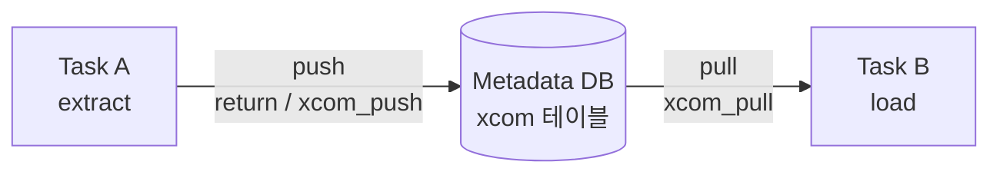
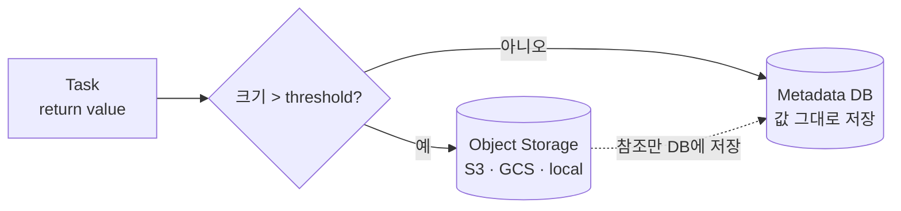

> **TL;DR**
>
> - XCom = **Cross-Communication**. 태스크 간 **작은 값**을 메타DB를 거쳐 주고받는 우체통
> - return 값은 자동으로 push되고(key=`return_value`), TaskFlow(`@task`)를 쓰면 push/pull 모두 자동
> - 큰 데이터는 직접 넘기지 말고, 외부 스토리지에 두고 **경로/ID만** 전달
> - **Object Storage XCom Backend**를 쓰면 큰 값만 S3 등에 자동 저장 가능 (threshold 기반 하이브리드)
{: .prompt-info }

## 이름의 유래

- **X = cross** (Ped Xing, X-platform과 같은 관습)
- 독립된 프로세스·워커로 나뉜 태스크 사이를 **가로질러** 통신한다는 의미

## 동작 구조



- 태스크끼리는 메모리를 공유할 수 없다 → DB를 중간 저장소로 사용한다.
- 구성: **key / value / dag_id·task_id·run_id**
- 값은 직렬화되어 저장된다 → JSON 직렬화가 가능한 값이 안전하다.

## 사용법

### 전통 방식 (PythonOperator)

```python
def extract(**context):
    return {"count": 42}   # 자동 push (key="return_value")

def load(**context):
    data = context["ti"].xcom_pull(task_ids="extract")
    print(data["count"])   # 42
```

### TaskFlow 방식 (@task)

```python
@task
def extract():
    return {"count": 42}

@task
def load(data):
    print(data["count"])

load(extract())   # push/pull 자동
```

## 주의

- 기본 백엔드는 메타DB에 저장한다 → 대용량 DataFrame이나 파일을 넘기면 DB가 비대해지고 성능이 떨어진다.
- 권장 패턴: 데이터는 S3/GCS에 두고, XCom에는 **경로만** 넘긴다.

## 외부 Object Storage에 저장하기



- 제공: `apache-airflow-providers-common-io`의 `XComObjectStorageBackend`
- 설정 예시 (1MB를 넘는 값만 S3에 gzip으로 압축 저장)

```ini
[core]
xcom_backend = airflow.providers.common.io.xcom.backend.XComObjectStorageBackend

[common.io]
xcom_objectstorage_path = s3://conn_id@mybucket/key
xcom_objectstorage_threshold = 1048576
xcom_objectstorage_compression = gzip
```

- `xcom_objectstorage_path`: 저장 위치. URL의 **user 부분이 Airflow connection id**다.
- `xcom_objectstorage_threshold`: 바이트 단위. **-1보다 커야** 활성화된다. 값이 작으면 DB, 크면 스토리지에 저장한다.
- `xcom_objectstorage_compression`: zip·gzip·bz2는 기본 지원하고, snappy 등은 추가 패키지가 필요하다.
- 태스크 코드는 그대로 둬도 된다 → `xcom_pull` 할 때 백엔드가 알아서 스토리지에서 읽어온다.
- 직접 구현도 가능하다: `BaseXCom`을 상속한 뒤 `serialize_value` / `deserialize_value`를 오버라이드한다.

## 참고

- [Object Storage XCom Backend 공식 문서](https://airflow.apache.org/docs/apache-airflow-providers-common-io/stable/xcom_backend.html)
